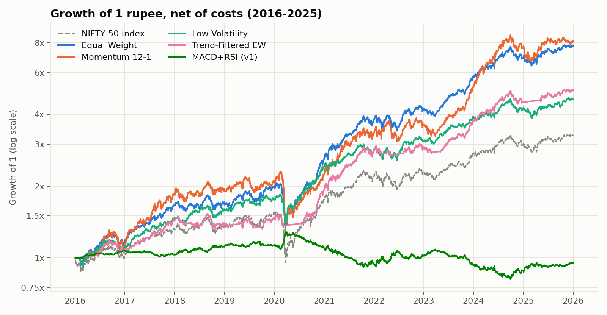
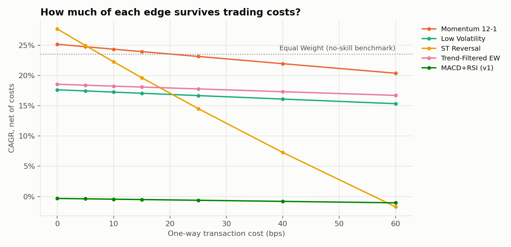
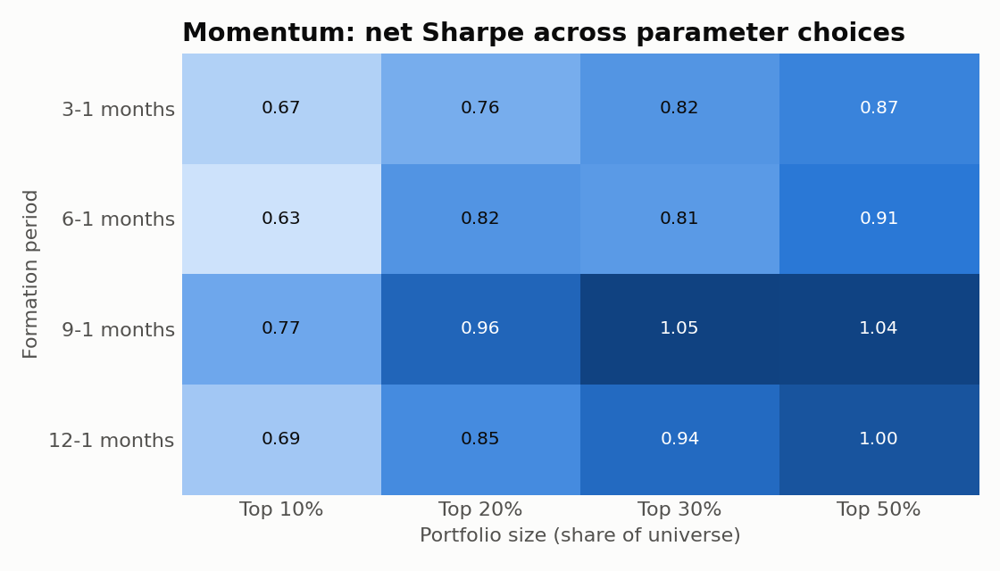
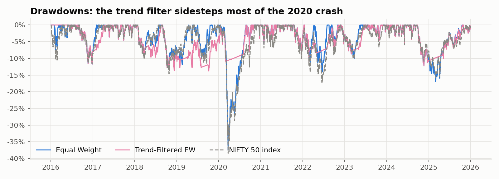
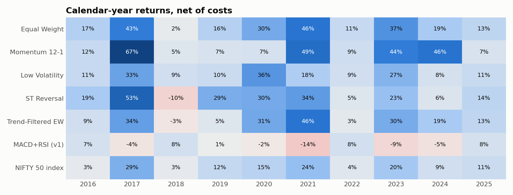
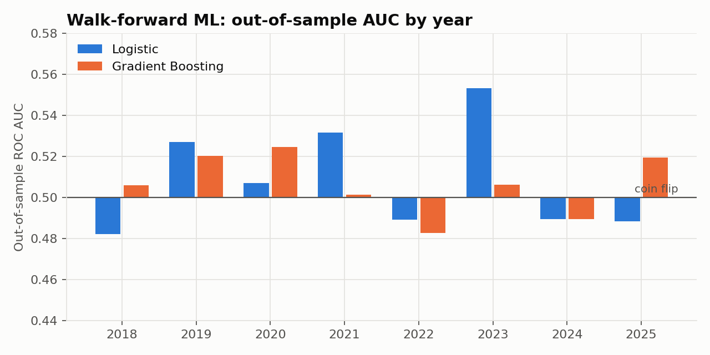
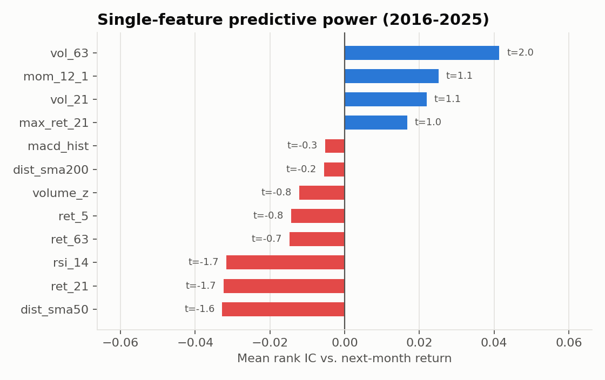

# NIFTY 50 Systematic Equity Research


**Do classic equity signals or a machine-learning ranker add value in Indian large caps once you account for trading costs, execution delay and survivorship bias?**

This project is a tested Python research framework. It backtests six systematic strategies and a walk-forward ML stock ranker on the 50 current NIFTY 50 constituents, using daily data from 2015 to 2025 (trading from 2016). One command (`python -m niftyquant`) reproduces every number and chart below.



## Key findings

| Strategy (net of 15 bps costs) | CAGR | Sharpe | Max DD | Calmar | Alpha vs NIFTY (t) | vs Equal Weight |
|---|---:|---:|---:|---:|---:|---:|
| **Equal Weight** (no-skill benchmark) | 23.4% | **1.01** | -37.5% | 0.62 | 9.2% (5.4) | – |
| Momentum 12-1 | 23.9% | 0.85 | -44.9% | 0.53 | 10.0% (2.5) | +0.6 pp |
| Low Volatility | 17.1% | 0.79 | -26.9% | 0.63 | 5.5% (2.2) | -6.3 pp |
| Short-term Reversal | 19.6% | 0.68 | -43.8% | 0.45 | 6.2% (1.6) | -3.8 pp |
| **Trend-Filtered EW** | 18.1% | 0.95 | **-13.8%** | **1.31** | 7.7% (2.7) | -5.3 pp |
| MACD + RSI (v1 rule) | -0.5% | -0.77 | -36.6% | – | -3.2% (-2.0) | -23.9 pp |
| ML Ranker (2018-25) | 23.0% | 0.79 | -39.6% | 0.58 | 9.5% (2.2) | +1.2 pp |
| NIFTY 50 index | 12.9% | 0.47 | -38.4% | 0.34 | – | -10.4 pp |

*Sample: Jan 2016 to Dec 2025. Sharpe uses a 6% risk-free rate. The ML row covers its own 2018-2025 test window (Equal Weight Sharpe over that window: 0.90). Full tables: [results/RESULTS.md](results/RESULTS.md).*

1. **Use the right benchmark.** An equal-weight basket of *today's* NIFTY 50 stocks beat the index by 10.4 pp a year, mostly because those stocks were picked with hindsight (survivorship bias). Every "alpha" against the index is inflated by this, so all strategies are judged against Equal Weight: same universe, no skill.
2. **No signal beats Equal Weight on a risk-adjusted basis.** All Sharpe 95% confidence intervals (block bootstrap) overlap, e.g. Equal Weight [0.28, 1.79] vs Momentum [0.16, 1.58].
3. **Costs decide the winner.** Short-term reversal has the largest gross return (27.7% CAGR), but it turns the portfolio over ~44x a year, and its edge over Equal Weight disappears at just **8 bps** one-way. Momentum's slim edge survives up to **23 bps**.
4. **Trend filtering is a risk tool, not a return engine.** Moving to cash when NIFTY is below its 200-day average cut the max drawdown from -37.5% to **-13.8%** and **doubled the Calmar ratio** (0.62 to 1.31), at a cost of about 5 pp of CAGR. Most of the benefit comes from one event (March 2020), so this evidence is thin.
5. **ML finds no reliable edge.** With purged walk-forward validation, gradient boosting and logistic regression average an out-of-sample **AUC of 0.51** (rank IC ≈ 0.01). The ranker's portfolio slightly beats Equal Weight in CAGR, but with a lower Sharpe and 14x turnover.
6. **The original v1 rule loses money**, which confirms the v1 conclusion with a far more rigorous test.



## What makes the backtest credible

- **Target**: 1 if the next 5-day return is positive.
- **Features**: scale-free ratios of MACD, RSI, SMA/EMA distance, volatility, momentum and volume, computed per ticker.
- **Split**: chronological, 80% train / 20% test, with a 10-day gap.
- **Result**: ROC AUC 0.529, accuracy 0.51 (test share of up-moves: 0.561), i.e. no reliable edge.
---
| Pitfall | How it is handled |
|---|---|
| Look-ahead bias | Signals use data up to close *t*; trades execute at close *t+1*. A unit test perturbs future prices and asserts that no past decision changes. Results are also shown for lags of 0, 1 and 2 days. |
| Unrealistic costs | 15 bps one-way (0.1% STT, stamp duty, exchange fees, slippage), charged on actual turnover; full grid from 0 to 60 bps with break-even costs. |
| Fake rebalancing | An event-driven simulator lets weights drift between rebalances; costs are paid only on real trades; idle cash earns the risk-free rate. |
| Survivorship bias | Quantified (EW-of-survivors vs index gap) and neutralised by benchmarking against Equal Weight. |
| Overfitting | Parameters come from the literature, not tuning. Robustness grids, a 2016-21 development / 2022-25 hold-out split, and bootstrap Sharpe CIs. |
| ML leakage | Cross-sectional target, expanding walk-forward by year, and a 21-day purge gap so no training label overlaps the test year. |
| Data errors | An automated large-move check flagged two demergers missing from Yahoo's adjusted prices (Adani Enterprises 2015, Tata Motors 2025); they are corrected explicitly. |
| Shorting constraints | Cross-sectional strategies are long-only (single-stock shorts are intraday-only in Indian cash markets); market exposure is reported via beta. |

## Robustness

<p float="left">
  
  
</p>

- **Momentum** delivers a positive net Sharpe for every formation period (3-12 months) and portfolio size tested (0.63 to 1.05). The effect is robust but not large.
- **Hold-out (2022-2025)**: the ranking is broadly stable. Equal Weight's Sharpe goes from 1.04 to 0.98, Momentum's from 0.77 to 1.00, and Reversal's degrades from 0.83 to 0.40.



## Machine learning

<p float="left">
  
  
</p>

- **Features:** 12 scale-free price/volume signals (returns over several horizons, 12-1 momentum, volatility, RSI, MACD histogram, distance from moving averages, volume z-score), each also as a cross-sectional percentile rank.
- **Target:** does the stock beat the cross-sectional median over the next 21 trading days?
- **Validation:** each year from 2018 to 2025 is predicted by models trained only on earlier years, with a 21-day purge.
- **Univariate ICs** show a mild short-term reversal effect (21-day return, RSI and distance from the 50-day average are all negative). None of them is significant at conventional levels.

## Project structure

```
├── src/niftyquant/
│   ├── config.py        # universe, dates, cost / risk-free assumptions
│   ├── data.py          # download, caching, cleaning, demerger adjustments
│   ├── features.py      # indicators (RSI, MACD, momentum, volatility, ML features)
│   ├── strategies.py    # six strategies -> target weights
│   ├── backtest.py      # event-driven simulator: drift, lag, costs, cash
│   ├── metrics.py       # Sharpe/Sortino/Calmar, CAPM alpha, bootstrap CIs
│   ├── ml.py            # purged walk-forward ML ranker, rank IC
│   ├── plots.py         # figures
│   └── pipeline.py      # end-to-end research run
├── tests/               # 21 tests: no-look-ahead, engine maths, costs, metrics, ML purging
├── notebooks/research_walkthrough.ipynb
├── docs/research_note.md   # 2-page write-up
├── data/                # cached prices (reproducible offline)
├── results/             # CSV tables + RESULTS.md
├── figures/
└── archive/v1/          # original project, kept for transparency
```

## Reproduce

```bash
git clone https://github.com/Yugdes/Nifty50-Algo-Trading-Strategy.git
cd Nifty50-Algo-Trading-Strategy
pip install -r requirements.txt && pip install -e .
pytest                      # 21 tests
python -m niftyquant        # regenerates results/ and figures/ (~15 s, uses cached data)
python -m niftyquant --refresh --cost-bps 25   # re-download data, different cost assumption
```

## Limitations and next steps

- **Universe:** today's constituents over the whole period. Point-in-time NIFTY membership would remove the survivorship bias rather than just controlling for it.
- **Benchmark:** NIFTY 50 is a price index, while stock returns include dividends, which adds roughly 1-1.5 pp a year to the measured gap.
- **Costs:** costs are modelled as a flat rate; market impact is ignored, which is reasonable for NIFTY 50 liquidity at small size.
- **Breadth:** 50 stocks give limited breadth for cross-sectional signals. Extending to the NIFTY 500 and adding fundamental factors (value, quality) are the natural next steps.

## Version history

v1 was a single MACD + RSI rule tested stock by stock, with no costs, plus a classifier whose AUC of 1.00 turned out to be target leakage. See [archive/v1](archive/v1/README.md) for what changed and why.

## Author

**Yug Desai**, IIT Gandhinagar · yug.desai@iitgn.ac.in

Data from Yahoo Finance via [yfinance](https://github.com/ranaroussi/yfinance). Started at Annuity, the Finance Club of IIT Gandhinagar.
